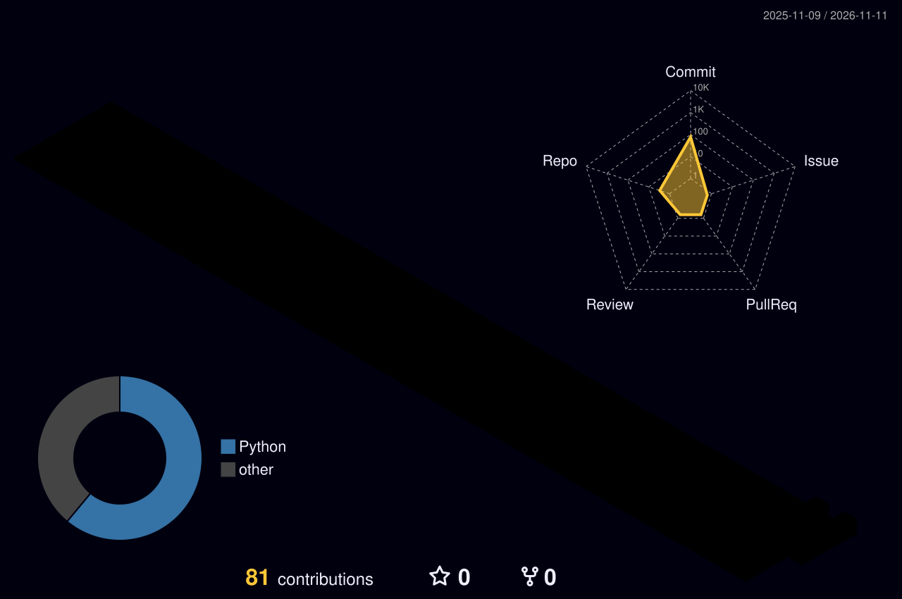

 

&nbsp;

&nbsp;

  

  

  

## 🛠️ Tech Stack & Arsenal (Neural Map)

  

## 👾 Arcade Contribution Graph

  <picture>
    <source media="(prefers-color-scheme: dark)" srcset="https://raw.githubusercontent.com/oyevipthoma88/oyevipthoma88/output/pacman-contribution-graph-dark.svg" />
    <source media="(prefers-color-scheme: light)" srcset="https://raw.githubusercontent.com/oyevipthoma88/oyevipthoma88/output/pacman-contribution-graph.svg" />
    
  </picture>

  

## 🏙️ 3D Contribution Skyline

  

  

## 🏆 Achievements & Trophies

  
  
  
   
  
  
  

  

